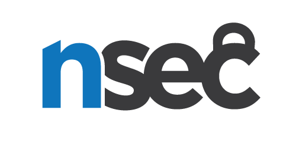

---
# Editing the below variables is the absolute minimum to get stuff up. Feel
# free [obliged] to add editorial niceties or strip the page if you need to
# include something more complex.
season: 23
episode: 06
layout: default
title: Hackfest - Mercury - a black hole in a galaxy far far away  
# summary for social media cards. Ideal length 55 chars, max 200
summary: Hackfest - Mercury - a black hole in a galaxy far far away    
tags: Hackfest bash
date_fr: 2026-11-18
date_long_fr: Mercredi le 18 novembre 2026 18:00 à 21:00
date_en: 11-18-2026
date_long_en: Wednesday november 18 2026 18:00 to 21:00
description_fr: >
   This CTF challenge is a strategy game played in your terminal over ssh.Your goal is to understand the game’s mechanics, complete missions, and uncover business logic flaws. Use your scripting skills to automate long running sessions and  defeat the biggest threat: Moth
description_en: >
   Ce défi CTF est un jeu de stratégie joué dans votre terminal via SSH. Votre objectif est de comprendre les mécaniques du jeu, de compléter des missions et de découvrir des failles de logique dans le jeu. Utilisez vos compétences en scripting pour automatiser les sessions longues et vaincre la plus grande menace : Moth.
tools_fr:
  - docker
  - bash 
  - python 
  - ssh
tools_en:
  - docker
  - bash 
  - python 
  - ssh
presented_by_fr: Défi présenté par Franck Holé - Thelkdo
presented_by_en: Presented by Franck Holé - Thelkdo
featured_img: /images/2026-10.jpeg
featured_img_alt: Mercury banner
location: CyberEco (355 Rue Peel Suites 203-208, Montréal, QC H3C 2G9)
---

# Next edition: {{ page.date_en }}
[French version](#french)

### Season {{ page.season }} Episode {{ page.episode }}

## {{ page.title }}

The next edition of Montrehack will be held on {{ page.date_long_en }}.

{{ page.description_en }}


{::options parse_block_html="true" /}

## Challenge Assets

* [ {{ asset.name }} ]({{ asset.url }})





{::options parse_block_html="true" /}

## Archives
This edition is over. Here are the archived assets:

* [ {{ asset.name }} ]({{ asset.url }})




## Tools and Experience Required


* {{ tool }}


## Where

* {{ page.location }}
* Follow the presentation [online on Twitch](https://twitch.tv/montrehack/)
* Participate in teams or on your own [on Discord](https://discord.gg/4qfFwPX)

## When

{{ page.date_long_en | capitalize }}

## How

* Workshop style
* Bring your own laptop
* Challenges will be analyzed
* Small groups of people can work on each challenge
* Solutions to each challenge will be presented to everyone at the end of the event

## Credits

{{ page.presented_by_en }}

# Prochaine édition: {{ page.date_fr }}

### Saison {{ page.season }} épisode {{ page.episode }}

## {{ page.title }}

La prochaine édition de Montréhack aura lieu {{ page.date_long_fr }}.

{{ page.description_fr }}


{::options parse_block_html="true" /}

## Challenge Assets

* [ {{ asset.name }} ]({{ asset.url }})





{::options parse_block_html="true" /}

## Les Archives
Cette édition est terminé, voici les archives:

* [ {{ asset.name }} ]({{ asset.url }})




## Outils et expérience requis


* {{ tool }}


## Où

* {{ page.location }}
* Suivez la présentation [en ligne sur Twitch](https://twitch.tv/montrehack/)
* Participez seul ou en équipe [sur Discord](https://discord.gg/4qfFwPX)

## Quand

{{ page.date_long_fr | capitalize]]

## Comment

* Formule atelier
* Apportez votre ordinateur portable
* Des problèmes seront étudiés et expliqués
* Chaque problème sera analysé en petits groupes
* Les solutions seront présentées avec tout le monde à la fin de la rencontre

## Remerciements

{{ page.presented_by_fr }}

### Sponsors // Partenaires

Interested to sponsor or present a challenge? [Contact us here](https://docs.google.com/forms/d/e/1FAIpQLSecc0vfe3pIwMJjIBCYW4G43ZwtagwVESu_qHKnglnBc3R3ww/viewform?usp=sf_link).